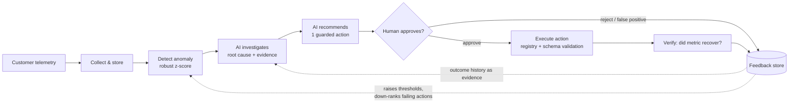

#OpsPilot — AI-Powered Incident Investigation and Human-Governed Remediation

> An AI agent that watches operational telemetry, detects anomalies, **investigates root cause**, **recommends a fix**, waits for a **human to approve**, executes the action through a **guarded registry**, then **verifies the result and learns from it**.

Built with Python · FastAPI · SQLite · Claude (Anthropic API) · pytest · Docker · GitHub Actions


---

## The problem

Enterprise content platforms (document capture/OCR, workflow queues, search indexing) fail in boring, expensive ways: OCR failure rates spike, queues stall, indexers fall behind. Today a human watches dashboards, guesses the cause, and runs a runbook by hand. Fully autonomous remediation is too risky for production, and plain alerting is too dumb. **OpsPilot sits in between: the AI does the investigation, the human keeps the decision.**

## The closed loop



## What makes this more than a demo

| Concern | How it is handled |
|---|---|
| **Safety** | The LLM can only *propose* actions from a typed registry (`actions.py`). Unknown actions or bad params are rejected. Nothing runs without explicit human approval. |
| **Reliability** | If the LLM is unavailable, returns invalid JSON, or proposes a disallowed action, the system falls back to a deterministic rule-based investigator. It also runs fully offline with no API key. |
| **Auditability** | Every state transition (detected → recommended → approved → executed → outcome) is written to an append-only `audit` table with actor and detail. |
| **Learning loop** | Verified outcomes are stored. Actions that repeatedly fail for a metric are down-ranked in future recommendations; "false positive" rejections raise that tenant/metric's detection threshold. |
| **Incident grouping** | Simultaneous anomalies (e.g. surge + latency + lag) become **one** incident so the investigator sees the full picture. |
| **Robust detection** | Median/MAD z-score over a rolling baseline instead of mean/stddev, which past spikes distort. |
| **Testability** | The core loop is framework-free and fully covered by tests, including the "system adapts after a failed fix" scenario. |

## Quickstart

```bash
git clone https://github.com/<your-username>/opspilot && cd opspilot
python -m venv .venv && source .venv/bin/activate
pip install -r requirements-dev.txt

# 1) Watch the whole loop in your terminal (no server, no API key needed)
python -m opspilot.demo --scenario ocr_degradation --auto
#    scenarios: ocr_degradation | ingestion_surge | stuck_queue | upstream_outage

# 2) Run the API + approval console
uvicorn opspilot.main:app --reload      # open http://127.0.0.1:8000  (docs at /docs)

# 3) Tests
pytest -q
```

To use a real LLM for investigation: `cp .env.example .env`, set `ANTHROPIC_API_KEY`, and export it. Without a key the rule-based investigator is used; the `source` field on each recommendation tells you which one ran.

### Example run

```
[1] COLLECT   ingesting 40 min of telemetry for 'acme-insurance' (incident injected at the end)
[2] DETECT
    CRITICAL anomaly on queue_latency_s: 55.0 vs baseline 8.4 (z=+47.6); related: ['ingestion_rate', 'indexing_lag_s']
[3] INVESTIGATE (AI)
    root cause: Ingestion surge exceeding processing capacity (confidence 80%)
      - queue_latency_s = 55.0 vs baseline 8.4 (z=+47.6)
      - ingestion_rate = 420.0 vs baseline 117.7 (z=+46.4)
      - indexing_lag_s = 90.0 vs baseline 19.9 (z=+25.0)
      - Normal: ocr_failure_rate
[4] RECOMMEND scale_workers {"service": "processing", "delta": 2}  [risk: low]
[5] HUMAN APPROVED -> Scaled 'processing' by +2 workers.
[6] VERIFY    system recovers; ingesting 3 more minutes of telemetry
[7] LEARN     {'status': 'resolved', 'post_action_z': [...]}
```

## API

| Method & path | Purpose |
|---|---|
| `POST /metrics` | Ingest telemetry `[{tenant, name, ts, value}]` |
| `POST /detect` | Run detection; returns new anomaly ids |
| `GET /anomalies` | List incidents (with related signals) |
| `POST /anomalies/{id}/investigate` | AI root-cause analysis → creates a recommendation |
| `GET /recommendations` | Recommendations with root cause, evidence, risk, status |
| `POST /recommendations/{id}/approve` | **Human approval** → executes the action |
| `POST /recommendations/{id}/reject` | Reject; `false_positive: true` tunes the detector |
| `POST /recommendations/{id}/evaluate` | Verify the outcome and store feedback |
| `GET /actions` · `GET /audit` | Action catalogue · audit trail |

## Repository layout

```
opspilot/
  detector.py      robust z-score detection, incident grouping, per-tenant thresholds
  investigator.py  LLM investigator (strict JSON + validation) and rule-based fallback
  actions.py       guarded action registry: risk levels + param schemas
  pipeline.py      orchestrator + recommendation state machine + feedback/learning
  simulator.py     synthetic telemetry and incident scenarios
  main.py          FastAPI app          static/index.html   approval console
  demo.py          terminal walkthrough db.py / config.py   storage and settings
tests/             detector, pipeline (incl. learning), API
docs/architecture.md   design decisions and trade-offs
```

## Design decisions & honest limitations

- **Actions are simulated.** `actions.py` returns messages instead of calling real systems. The registry is the integration seam: replace each function with a real call (Kubernetes, queue broker, content-platform admin API, PagerDuty).
- **Synthetic data.** On the simulator's healthy data the detector at `z=6` produced about 1 false positive in 300 runs and missed 0 of 200 injected incidents. Real telemetry (seasonality, trends) needs more work; see the roadmap.
- **SQLite** keeps setup to zero. Move to Postgres + migrations for multi-user deployments.
- **No auth yet.** The `approver` field is self-declared. Production needs real identity and role-based approval (e.g. high-risk actions need two approvers).

## Roadmap

- [ ] Seasonality-aware baselines (hour-of-day / day-of-week)
- [ ] Auth (OAuth/OIDC) and role-based approval policies
- [ ] Real connectors: Prometheus ingestion, Kubernetes actions, Slack approval buttons
- [ ] Retrieval over runbooks / past incidents (vector search) as extra LLM evidence
- [ ] Offline evaluation harness for investigator accuracy across scenarios
- [ ] Postgres + Alembic, OpenTelemetry tracing of each loop stage

## License

MIT
